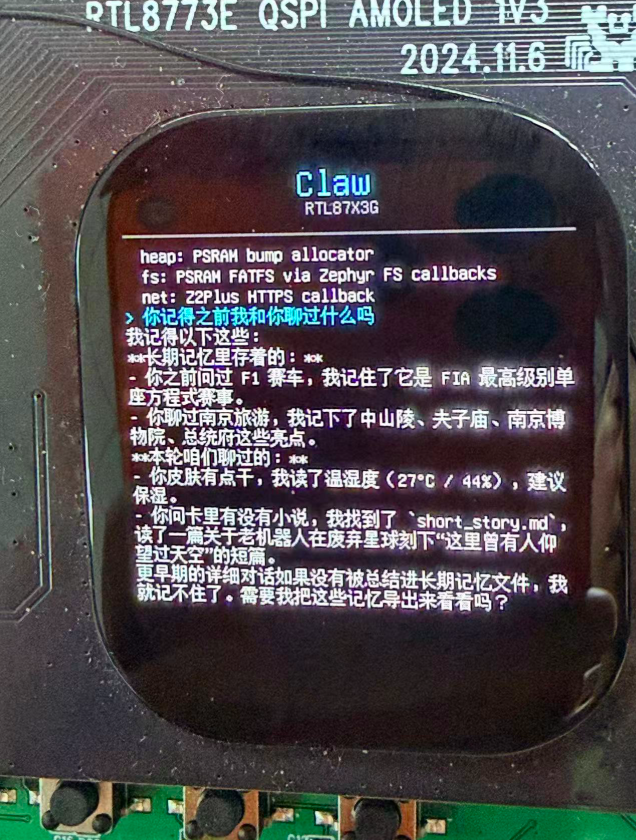
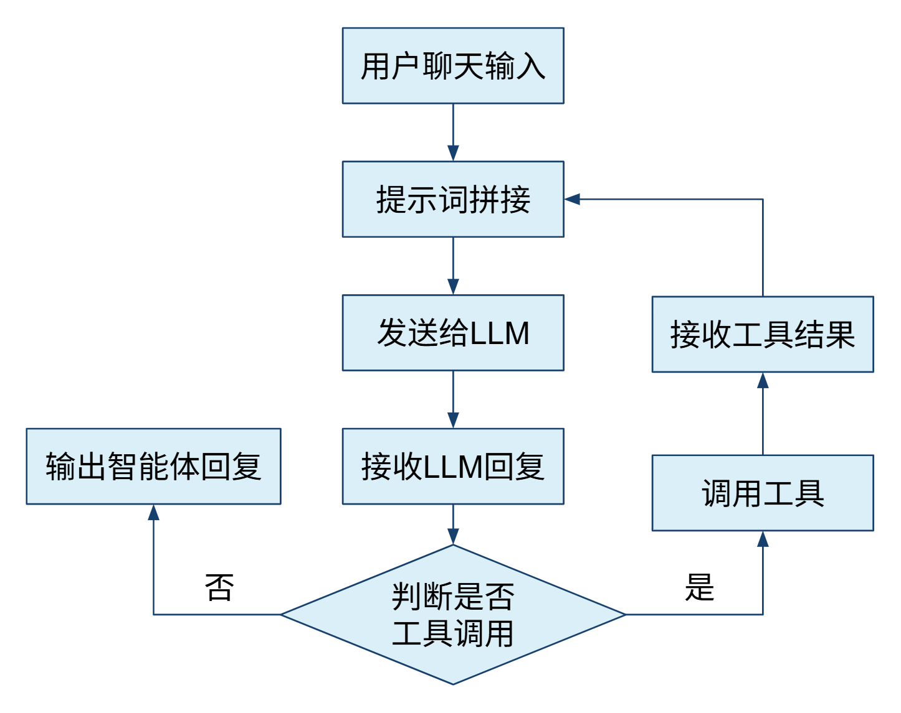

# CLAW Introduction

- CLAW is an AI agent running on the MCU (RTL8783G).

- It integrates the cloud large language model, the local agent, peripheral drivers, and network capabilities to realize MCU applications based entirely on natural language

- Chat through Feishu, the onboard screen, or a serial terminal

- The agent can operate peripherals (lights, SD card, sensors) and the operating system (scheduled tasks, signal monitoring); it has long-term memory and knows its own and the user's identity

## Example Showcase

### Detect the air and write a diary

Through multiple rounds of tool calls, CLAW:
- Understood that the current environment for air detection can only measure temperature and humidity
- Performed a temperature/humidity read and obtained the results
- Summarized the results into natural language
- Created a new file on the SD card and wrote the air detection results
- Retrieved the SD card operation result and summarized it into a natural-language reply

### Control the light strip

- CLAW learned the light strip control syntax in the system prompt
- Generated light strip control commands
- Analyzed the command execution results
- Replied with the expected control effect in natural language

<video src="%E5%BD%A9%E8%99%B9%E7%81%AF%E5%B8%A6.mp4" controls width="100%"></video>

### Know its identity

- Through the role file, CLAW learned its own identity and runtime environment
- Chat content is displayed on both Feishu and the local screen

### Detect humidity and warn

Through multiple rounds of tool calls, CLAW:
- Learned how to use the light and the monitor
- Set up a monitor,
- Replied in natural language that the monitor was set up successfully

In the video, spraying triggered the humidity warning (light on)

<video src="%E5%96%B7%E9%9B%BE.mp4" controls width="100%"></video>

### Long-term memory

## CLAW Core

Agent loop
From the chat history, you can see that CLAW often has multiple cycles of code replies before it can finally produce a fluent natural-language reply. This is an important advantage of CLAW over a standalone large language model, and it is the core process that enables it to perform complex tasks.

The prompt assembly includes:
- User input
- Role file
- Long-term memory
- Current chat history
- Tool calling syntax
- Possibly tool execution results

## Architecture

- It makes full use of the onboard chip and peripheral capabilities, implementing communication with the LLM server and the Feishu server, the agent core loop, tool command invocation, and other features that support CLAW's implementation;

