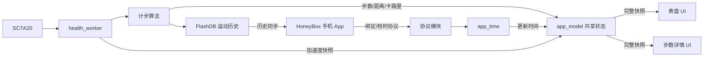

> **Historical reference:** the app_model architecture below is obsolete. See the "Firmware sysval migration" section at the end for current firmware behavior.

# 手表 MDA 共享状态架构开发指南

## 1. 目的

本项目使用模型驱动架构（Model-Driven Architecture，MDA）在业务模块和 UI 之间同步状态。

核心规则是：

> 业务模块只更新共享模型，UI 只读取完整状态快照；业务模块不直接调用 UI API，UI 也不直接调用传感器、RTC 或数据库 API。

这种方式用于避免以下问题：

- 传感器线程直接操作 GUI，造成线程安全问题；
- UI 与业务模块互相调用，形成循环依赖；
- UI 在多个字段更新到一半时读到不一致数据；
- 同一份业务数据在多个表盘中各自维护，导致显示不一致；
- 模拟数据、RTC 数据和真实传感器数据混用。

当前共享模型位于：

- `app/app_model/app_model.h`
- `app/app_model/app_model.c`

---

## 2. 总体数据流



这里有两条不同的数据链：

1. **实时 UI 数据**：业务模块 → `app_model` → UI。
2. **App 历史数据**：业务模块 → FlashDB → BLE 协议 → HoneyBox。

`app_model` 是运行时显示模型，不替代 FlashDB。设备重启后，当前活动汇总会从零开始；历史记录仍由 FlashDB 保存。

---

## 3. 完整状态快照

共享结构体为 `app_model_snapshot_t`：

| 字段 | 单位/含义 | 写入方 |
|---|---|---|
| `revision` | 状态版本，每次模型更新递增 | `app_model` |
| `updated_ms` | 最近一次模型更新时的 Zephyr uptime，毫秒 | `app_model` |
| `wall_clock_sec` | UI 应显示的墙上时钟秒 | `app_time` |
| `steps` | 当日累计步数 | `health_worker` |
| `distance_m` | 当日累计距离，米 | `health_worker` |
| `calories_dkcal` | 当日累计热量，0.1 kcal | `health_worker` |
| `accel_x_mg` | X 轴加速度，mg | `health_worker` |
| `accel_y_mg` | Y 轴加速度，mg | `health_worker` |
| `accel_z_mg` | Z 轴加速度，mg | `health_worker` |
| `time_valid` | 时间是否已有可信来源 | `app_time` |
| `accel_valid` | 加速度传感器当前是否在线 | `health_worker` |

UI 必须通过以下接口一次复制整个结构体：

```c
app_model_snapshot_t snapshot;
app_model_get_snapshot(&snapshot);
```

禁止让 UI 直接访问 `app_model.c` 内部变量，也不要为每一个字段分别调用 getter。一次获取完整快照才能保证多个字段来自同一个一致状态。

---

## 4. 并发模型

`app_model.c` 使用 Zephyr `k_mutex` 保护共享结构体。

### 写操作

所有写接口都遵循以下顺序：

1. 获取 `s_model_mutex`；
2. 在同一个临界区更新相关字段；
3. 递增 `revision`；
4. 更新 `updated_ms`；
5. 释放互斥锁。

例如步数、距离和卡路里必须作为一组更新：

```c
app_model_update_activity(steps, distance_m, calories_dkcal);
```

不要拆成三个独立 setter，否则 UI 可能读到新步数和旧距离的混合状态。

### 读操作

`app_model_get_snapshot()` 在锁内复制整个模型，随后 UI 使用自己的局部副本。UI 不应持有模型锁执行格式化、绘制或文件操作。

### 中断上下文限制

当前 API 使用 `k_mutex_lock(..., K_FOREVER)`，因此：

> 不允许从 ISR 中调用任何 `app_model_*` 接口。

若未来必须从 ISR 更新数据，应先投递事件或消息到线程，再由线程更新模型。

---

## 5. 时间模型

### 5.1 时间来源

实体手表的可信时间来自 HoneyBox 的设置时间命令：

```text
HoneyBox → hmi_l2_cmd_settings → app_time_set → RTC + app_model
```

`app_time_set()` 成功写入硬件 RTC 后调用：

```c
app_model_update_time(sec);
```

启动时，如果 RTC 中已有有效时间，`app_time` 也会把它写入共享模型。

### 5.2 时间推进

模型保存的是：

- 最近一次同步的 `wall_clock_sec`；
- 同步时的 `k_uptime_get_32()`。

读取快照时，当前时间按以下方式计算：

$$
T_{current} = T_{base} + \frac{U_{current} - U_{base}}{1000}
$$

这样 UI 不依赖 libc 的 `time(NULL)`，也不会将模拟器时间误当成硬件 RTC 时间。

### 5.3 UI 使用方式

主要表盘通过 `src/user/ui_model_time.h` 读取时间。

实体固件：

- 从 `app_model` 获取时间；
- `time_valid == false` 时不刷新为虚假时间；
- 使用 `gmtime_r()`展开墙上时钟字段，不再次施加时区偏移。

HoneyGUI 模拟器：

- 使用开发电脑的 `time(NULL)`；
- 仅作为设计预览，不代表实体设备数据来源。

当前已经接入共享时间的页面：

- 第一表盘数字时间和星期；
- 第五表盘模拟时针、分针和秒针。

其他 Designer 生成页面仍可能直接使用 `time(NULL)`。后续修改时应逐步迁移到 `ui_model_time_get()`。

---

## 6. 运动模型

### 6.1 启动条件

运动采集只有在以下条件同时满足时启动：

- 编译开关 `HEALTH_ACQUISITION_ENABLED == 1`；
- 收到 `EVT_TIME_SYNCED`；
- 收到 `EVT_USER_BOUND`。

这是为了确保运动记录具有可信时间戳，并归属于已绑定用户。

正常日志顺序应包含：

```text
EVT_USER_BOUND received
EVT_TIME_SYNCED received
worker armed: time_synced && user_bound
gsensor online
worker started
```

### 6.2 采样与模型更新

`health_worker` 以 25 Hz 读取 `/dev/gsensor0`：

- 每次成功采样调用 `app_model_update_accelerometer()`；
- 计步算法产出结果时，更新当日累计值；
- 随后调用 `app_model_update_activity()`，一次发布步数、距离和卡路里。

UI 不读取 `health_worker` 的内部累计器，也不直接打开传感器。

### 6.3 重置和离线

以下场景会清零活动模型：

- 新的一天开始；
- 用户解绑并丢弃当前用户数据；
- 健康 worker 重新开始当天 RAM 汇总。

worker 退出时调用 `app_model_set_accelerometer_offline()`，将 `accel_valid` 设为 `false`。

---

## 7. UI 接入规范

### 正确示例

```c
void page_tick(void *obj)
{
    GUI_UNUSED(obj);

    app_model_snapshot_t snapshot;
    app_model_get_snapshot(&snapshot);

    snprintf(step_buffer, sizeof(step_buffer), "%lu",
             (unsigned long)snapshot.steps);
    gui_text_content_set(step_label, step_buffer,
                         (uint16_t)strlen(step_buffer));
}
```

### 必须注意

HoneyGUI 的 `gui_text_content_set()` 保存的是字符串指针，不保证复制字符串内容。因此显示缓冲区必须长期有效：

```c
static char step_buffer[12];
```

禁止使用函数栈上的临时字符数组作为长期显示内容。

### 禁止的调用方向

```text
health_worker → clock1st_set_steps()       禁止
UI → posix_read("/dev/gsensor0")          禁止
UI → health_worker_get_today()             不推荐
app_time → gui_text_content_set()          禁止
```

推荐方向始终是：

```text
业务模块 → app_model ← UI
```

---

## 8. 新增字段的标准流程

例如后续增加电量字段：

1. 在 `app_model_snapshot_t` 增加字段及有效标志；
2. 在 `app_model.h` 声明面向业务语义的更新函数；
3. 在 `app_model.c` 中锁内完成整组更新；
4. 由电源模块调用更新函数；
5. UI 定时器读取一次完整快照；
6. UI 根据有效标志决定显示数值、占位符或离线图标；
7. 编译并在实机日志中验证生产者确实更新了模型。

建议接口：

```c
void app_model_update_power(uint8_t percent, bool charging);
```

不建议接口：

```c
void app_model_set_battery_percent(uint8_t percent);
void app_model_set_charging(bool charging);
```

前者能保证相关字段原子更新。

---

## 9. 单位和有效性约定

新增字段时必须在头文件中写清单位，禁止依赖调用者猜测。

推荐使用整数单位：

- 距离：米 `m`；
- 加速度：毫重力 `mg`；
- 热量：0.1 千卡 `dkcal`；
- 心率：次/分钟 `bpm`；
- 时间：1970 epoch 的墙上时钟秒。

尚未取得真实数据时，不要填充演示值冒充真实数据。应增加 `*_valid` 或状态枚举，让 UI 明确显示未同步、离线或暂无数据。

---

## 10. 当前能力与限制

### 已接入

- 手机校时 → 共享时间模型；
- SC7A20 三轴加速度状态；
- 当日步数；
- 当日距离；
- 当日卡路里；
- 第一表盘、第五表盘和步数详情页读取模型。

### 尚未接入

- 真实心率；
- 睡眠数据；
- 电量和充电状态；
- 所有其他带时间标签的页面；
- 模型变更的主动订阅通知机制。

当前 UI 使用定时器轮询快照。若将来字段和页面明显增多，可以增加“模型更新事件”，但事件只能通知 UI 重新读取快照，不应把大量独立字段作为事件载荷传播。

---

## 11. 构建和固件说明

应用代码编译产物：

```text
applications/bin/app.bin
```

HoneyGUI ROMFS 资源固件：

```text
UIproj/smartwatchui360360/build/app_romfs_0x704D1000.bin
```

ROMFS 固件主要包含图片和字体资源，烧录地址为 `0x704D1000`，必须与 `project.json`、`smartwatch_ui_360360Entry.c` 和 flash map 保持一致。C 代码逻辑修改进入 `app.bin`，通常不需要重新生成 ROMFS；只有资源文件或 ROMFS 内容变化时才需要更新资源固件。

常用验证日志：

```text
wall clock set ...
EVT_TIME_SYNCED received
EVT_USER_BOUND received
worker armed: time_synced && user_bound
gsensor online
gsensor sample ...
pedo update ...
```

---

## 12. 代码评审检查表

新增或修改 MDA 数据时，评审者应确认：

- [ ] 业务模块没有直接调用 GUI API；
- [ ] UI 没有直接访问硬件、数据库或业务模块内部状态；
- [ ] UI 一次读取完整快照；
- [ ] 相关字段在同一个锁临界区更新；
- [ ] 接口未从 ISR 调用；
- [ ] 每个字段的单位和有效性定义明确；
- [ ] 实体固件没有使用演示默认值冒充真实数据；
- [ ] 模拟器兼容逻辑通过 `_HONEYGUI_SIMULATOR_` 隔离；
- [ ] 新字段已覆盖重置、离线、解绑和跨日行为；
- [ ] 编译成功，并通过实机日志验证生产者和消费者链路。

## Firmware sysval migration (2026-10)

The firmware no longer builds or reads `app/app_model`. The HoneyGUI adapter
`port/ui/gui_firmware_sysval.c` is registered before app modules initialize.
It reads time from `app_time` (RTC), steps/distance/energy from the locked
health-worker RAM accumulator, and firmware version from Zephyr's generated
`APP_VERSION_STRING`. Battery level and charging are cached by the power module;
Bluetooth link state is cached by the BLE connection callback. An unavailable
clock or invalid battery level returns `GUI_SYSVAL_STATUS_ERROR`, not zero.

Available standard keys: `system/time` (seconds since local midnight),
`system/date` (YYYYMMDD), `system/time_synced`, `health/pedometer/steps`,
`health/pedometer/distance` (metres), `health/pedometer/calories` (whole kcal),
`power/battery/level`, `power/battery/charging`,
`connectivity/bluetooth/connected`, and `device/firmware_version`.
`health/heart_rate`, `health/sleep/deep`, and `health/sleep/light` are
not registered: there are no measurement backends for these values; the UI
must handle invalid requests rather than interpreting fabricated zeroes. To retain BLE
schema v2 units, the firmware also exposes private `watch/time/epoch_seconds`
(32-bit signed seconds) and `watch/health/calories_dkcal` (0.1 kcal).
The L2 MODEL GET command posts to the GUI queue, chains asynchronous sysval
reads there, then posts the serialized response to the L2 task (which owns
`proto_send`). It is no longer an immediate reply. Requests rejected by a
full queue are dropped and logged. Multiple sysval reads are not an atomic
snapshot; phone fields may come from adjacent sampling instants.

The older app_model description above documents the historical design, not
current firmware behavior.
